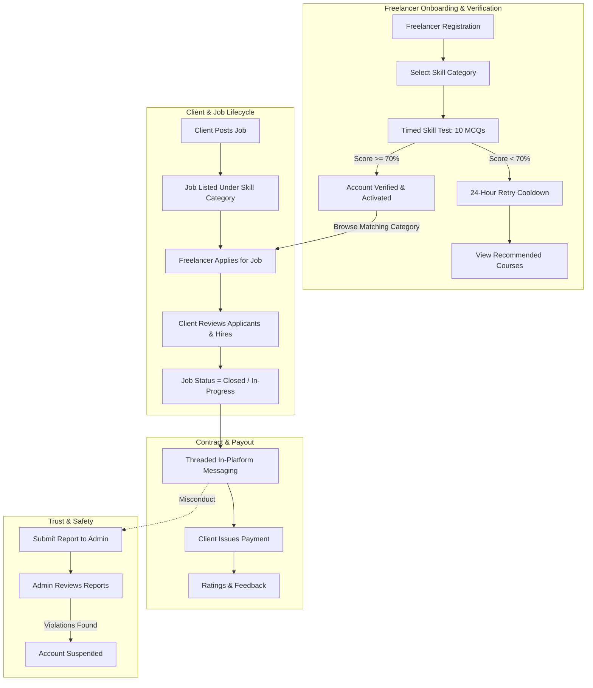

# FreelanceHub ◐

> **A Skill-Verified Freelance Marketplace Web Platform**  
> Connecting clients with tested, qualified freelancers through an automated skill assessment and moderation ecosystem.

---

## 📋 Table of Contents

- [About The Project](#-about-the-project)
- [Key Features](#-key-features)
  - [Freelancer Portal](#-freelancer-portal)
  - [Client Portal](#-client-portal)
  - [Administrator Portal](#-administrator-portal)
  - [Trust & Safety (Reporting & Moderation)](#-trust--safety)
- [Workflow Diagram](#-workflow-diagram)
- [Technology Stack](#-technology-stack)
- [Database Schema](#-database-schema)
- [Installation & Local Setup](#-installation--local-setup)
  - [Prerequisites](#prerequisites)
  - [Step 1: Clone Repository](#step-1-clone-repository)
  - [Step 2: Start Apache & MySQL](#step-2-start-apache--mysql)
  - [Step 3: Database Import](#step-3-database-import)
  - [Step 4: Database Configuration](#step-4-database-configuration)
  - [Step 5: Run Application](#step-5-run-application)
- [Demo Credentials](#-demo-credentials)
- [Project Directory Structure](#-project-directory-structure)
- [Troubleshooting & Common Issues](#-troubleshooting--common-issues)
- [Contributing & License](#-contributing--license)

---

## 💡 About The Project

Unlike traditional freelance websites where anyone can immediately bid on jobs regardless of competence, **FreelanceHub** introduces an **automated skill verification gate**:

1. **Mandatory Testing**: Freelancers must select their skill domain and pass a randomized, timed 10-question multiple-choice assessment with at least **70%** before they can finalize their profile and apply for jobs.
2. **Upskilling & 24h Cooldown**: If a candidate fails, their registration is blocked for 24 hours, and they are automatically directed to curated learning courses mapped to that skill.
3. **Skill-Gated Job Matching**: Once verified, freelancers can only view and apply to open jobs matching their verified specialty, eliminating spam proposals for clients.
4. **Transparent Accountability**: Clients and freelancers can review profiles, track report histories, communicate via job-linked chat, and process milestone payments.

---

## ✨ Key Features

### 💼 Freelancer Portal
- **Skill Verification Quiz Engine**: Automated, randomized 10-question quiz with a countdown timer (2 minutes) and real-time pass/fail evaluation.
- **Personalized Course Recommendations**: Instant suggestions of recommended courses upon test failure.
- **Skill-Filtered Job Feed**: Browse active jobs matching verified skills; proposals for unmatched domains are automatically excluded.
- **Application Tracking**: Monitor status of submitted job applications.
- **Direct Client Messaging**: Threaded in-platform messaging with clients for contracted jobs.
- **Earnings & Wallet**: Track milestone payments received from clients.
- **Profile Customization**: Edit bio, upload profile picture, and manage account credentials.

### 🏢 Client Portal
- **Job Posting & Management**: Post new jobs specifying title, skill category, detailed requirements, and budget.
- **Applicant Review & Hiring**: Inspect verified freelancer profiles, evaluate applicants, and hire selected candidates.
- **Contract & Payment Processing**: Manage contracted freelancers and submit milestone payments upon completion.
- **In-App Messaging**: Real-time communication channel with hired freelancers.
- **Safety Oversight**: View freelancer profiles and their report counts prior to hiring.

### 🛡️ Administrator Portal
- **Analytical Dashboard**: Live metrics on registered users, active skills, quiz question counts, courses, and pending reports.
- **Skill Management**: Add, update, or remove skill categories.
- **Quiz Bank Management**: Full CRUD operations for questions, answer choices (A, B, C, D), and correct answer keys.
- **Course Catalog Management**: Link educational courses and external learning resources to specific skills.
- **Moderation & User Suspension**: Review abuse/fraud reports submitted by users and suspend or restore accounts. Suspended accounts are immediately denied login access across all portals.

### 🔒 Trust & Safety
- **Job-Linked User Reporting**: Clients and freelancers can report each other once per job for violations, non-payment, or harassment.
- **Report Badges**: User profiles display their historical report count for transparent vetting.
- **Account Suspension Check**: Real-time status enforcement during authentication.

---

## 🔄 Workflow Diagram



---

## 🛠️ Technology Stack

| Layer | Component | Details |
|---|---|---|
| **Backend** | PHP 7.4+ / 8.x | Procedural & OOP with `mysqli` prepared statements |
| **Database** | MySQL / MariaDB | Relational schema with foreign keys, indexes, and cascades |
| **Frontend** | HTML5, CSS3, JavaScript | Modern CSS (Flexbox, CSS Grid, Inter typography, custom UI) |
| **Authentication** | Scoped PHP Sessions | Isolated session namespaces (`CLIENT_SESSION`, `FREELANCER_SESSION`, `ADMIN_SESSION`) |
| **Server** | Apache (XAMPP) | Document root hosted under `htdocs/FreelanceHub` |

---

## 🗄️ Database Schema

The database `freelancehub` includes the following core relational tables:

- `skill_categories`: Defined skill disciplines (e.g., Web Development, Mobile App Development).
- `freelancers`: Freelancer profiles, verification status (`is_verified`), suspension status, and bio.
- `clients`: Client accounts and suspension status.
- `admins`: Administrative accounts.
- `questions` & `question_options`: Question bank and MCQ option choices with designated correct answers.
- `freelancer_test_attempts` & `test_answers`: Audit trail of all test scores, attempts, and pass/fail states.
- `jobs` & `job_applications`: Job listings, required skills, budgets, and freelancer applications.
- `hired_freelancers`: Active and completed hiring contracts.
- `messages`: Threaded messages exchanged between clients and freelancers for a given job.
- `payments`: Financial records and status for completed hires.
- `ratings`: Post-project reviews and 1–5 star ratings.
- `courses` & `skill_courses`: Recommended educational resources mapped to skills.
- `user_reports`: User misconduct complaints and moderation tickets.

---

## 🚀 Installation & Local Setup

### Prerequisites

Ensure you have the following installed on your machine:
- [XAMPP](https://www.apachefriends.org/index.html) (with Apache & MySQL)
- [Git](https://git-scm.com/)
- A modern web browser (Chrome, Firefox, Edge)

---

### Step 1: Clone Repository

> [!IMPORTANT]
> The folder name inside `htdocs` **must be exactly `FreelanceHub`** (case-sensitive) because the application uses absolute URL paths (e.g., `/FreelanceHub/css/...`).

Open your terminal or Git Bash and clone the repository directly into your XAMPP `htdocs` directory:

```bash
cd C:/xampp/htdocs
git clone https://github.com/webLab-project/FreelanceHub.git
```

On Linux:
```bash
cd /opt/lampp/htdocs
git clone https://github.com/webLab-project/FreelanceHub.git
```

---

### Step 2: Start Apache & MySQL

1. Open the **XAMPP Control Panel**.
2. Click **Start** for **Apache**.
3. Click **Start** for **MySQL**.
4. Ensure both services show green status.

---

### Step 3: Database Import

1. Open your browser and navigate to **phpMyAdmin**:
   ```
   http://localhost/phpmyadmin
   ```
2. Click **New** on the left sidebar to create a database named:
   ```sql
   freelancehub
   ```
3. Select the newly created `freelancehub` database.
4. Click the **Import** tab at the top.
5. Click **Choose File** and select `freelancehub.sql` from your project folder:
   ```
   C:\xampp\htdocs\FreelanceHub\freelancehub.sql
   ```
6. Click **Import** (or **Go**) at the bottom.

*Alternatively, import via MySQL CLI:*
```bash
mysql -u root -p freelancehub < freelancehub.sql
```

---

### Step 4: Database Configuration

Open `db_config.php` and verify that the database credentials match your local MySQL configuration:

```php
<?php
$DB_HOST = "localhost";
$DB_USER = "root";
$DB_PASS = "";
$DB_NAME = "freelancehub";
$DB_PORT = 3307; // Change to 3306 if your MySQL uses default port!

$conn = new mysqli($DB_HOST, $DB_USER, $DB_PASS, $DB_NAME, $DB_PORT);

if ($conn->connect_error) {
    die("Database connection failed: " . $conn->connect_error);
}

$conn->set_charset("utf8mb4");
```

> [!TIP]
> Standard XAMPP installations run MySQL on port `3306`. If your XAMPP MySQL is on `3306`, change `$DB_PORT = 3306;` in `db_config.php`.

---

### Step 5: Run Application

Open your browser and navigate to:

```
http://localhost/FreelanceHub
```

To access the administrative portal:
```
http://localhost/FreelanceHub/admin/adminLogin.php
```

---

## 🔑 Demo Credentials

You can use the following pre-seeded test accounts to explore all portals:

| Portal | Role | Email | Password | Details |
|---|---|---|---|---|
| **Admin** | Super Administrator | `a@gmail.com` | `1234` | Full access to quiz bank, users, courses |
| **Admin** | Administrator 2 | `a2@gmail.com` | `1234` | Secondary admin account |
| **Client** | Client User | `c2@gmail.com` | `222222` | Can post jobs, hire, message, and pay |
| **Client** | Client User | `c3@gmail.com` | `222222` | Active client account |
| **Freelancer** | Verified Freelancer | `f1@gmail.com` | `111111` | Skill: Web Development (Verified) |
| **Freelancer** | Verified Freelancer | `sadat@gmail.com` | `111111` | Skill: Mobile App Development (Verified) |

---

## 📁 Project Directory Structure

```
FreelanceHub/
├── admin/                         # Administrator Panel
│   ├── actions/                   # Admin action scripts (CRUD courses, skills, quizzes, user bans)
│   ├── css/                       # Stylesheets for admin views
│   ├── pages/                     # Subpages (dashboard, users, skills, quizzes, courses)
│   ├── adminLogin.php             # Admin authentication view
│   ├── adminLogout.php            # Admin session termination
│   ├── admin_auth_check.php       # Admin route guard
│   └── dashboard.php              # Main admin layout & router
├── client/                        # Client Portal
│   ├── actions/                   # Client actions (post job, hire, pay, message, report)
│   ├── css/                       # Client UI stylesheets
│   ├── pages/                     # Views (home, post-job, my jobs, freelancers, messages, payments, settings)
│   ├── clientSignup.php           # Client registration
│   ├── dashboard.php              # Main client dashboard router
│   └── logout.php                 # Client session signout
├── freelancer/                    # Freelancer Portal
│   ├── actions/                   # Freelancer actions (apply job, send message, report, profile update)
│   ├── css/                       # Freelancer UI stylesheets
│   ├── pages/                     # Views (home, jobs, applications, earnings, messages, profile)
│   ├── course_offerings.php       # Upskilling recommendations for failed tests
│   ├── dashboard.php              # Main freelancer dashboard router
│   ├── freelancerSignup.php       # Initial freelancer registration
│   ├── freelancerTestrules.php    # Pre-quiz rules and briefing
│   ├── skilltest.php              # Timed 10-question MCQ quiz runner
│   ├── test_result.php            # Score evaluation and pass/fail gate
│   └── logout.php                 # Freelancer session signout
├── css/                           # Global stylesheets (base style, login, signup selection)
├── img/                           # Application branding and media assets
├── auth_check.php                 # Global session guard helpers
├── db_config.php                  # Database connection configuration
├── footer.php                     # Global page footer
├── freelancehub.sql               # Full database schema and sample seed data
├── header.php                     # Global page navbar and header
├── index.php                      # Public landing page
├── login.php                      # Unified login view (freelancers & clients)
├── process_login.php              # Login verification & role-based dispatch
├── signupOpt.php                  # Role picker for new accounts
└── README.md                      # Project documentation
```

---

## ❓ Troubleshooting & Common Issues

- **`Database connection failed: Connection refused`**:
  Check `$DB_PORT` in `db_config.php`. If your MySQL port in the XAMPP Control Panel says `3306`, change `$DB_PORT = 3307;` to `$DB_PORT = 3306;`.
- **404 Errors or Broken CSS/JS Paths**:
  Ensure the directory inside `htdocs` is named exactly `FreelanceHub` (matching the capitalization in URL links).
- **"Complete skill test first" Error on Login**:
  Freelancers cannot sign in until they have completed and passed the skill verification test with a score of 70% or higher.
- **"You failed the test recently. Please try again after 24 hours"**:
  Freelancers who fail the skill test must wait 24 hours before attempting it again. You can adjust or reset attempts directly in the `freelancer_test_attempts` database table during development.
- **"Your account has been suspended"**:
  The user has been suspended by an administrator. Status can be changed in the admin panel or by updating `is_suspended = 0` in the database.

---

## 📄 Contributing & License

This repository is maintained as part of the **webLab-project** organization.

1. Fork or branch from `main`.
2. Commit your changes (`git commit -m 'Add new feature'`).
3. Push to your branch (`git push origin feature/new-feature`).
4. Open a Pull Request.

Distributed under the MIT License. See `LICENSE` for more information (if applicable).
